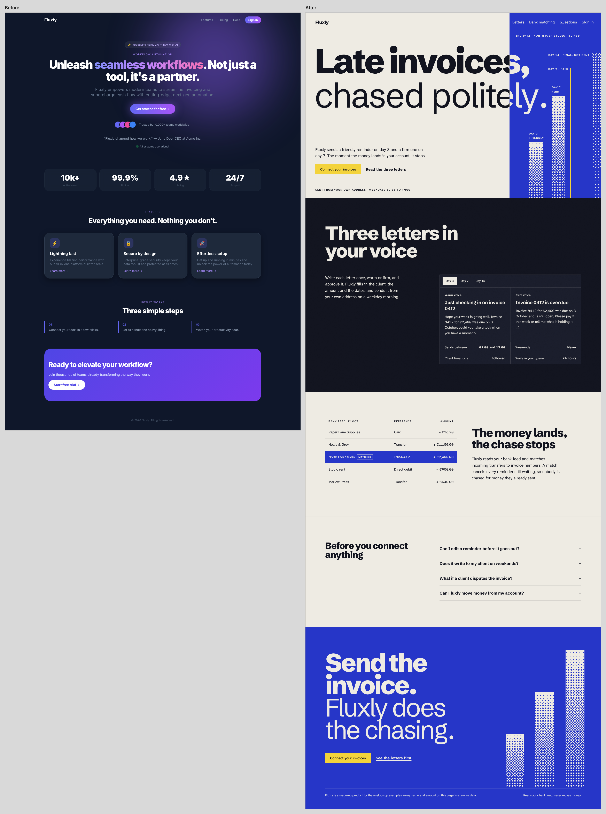
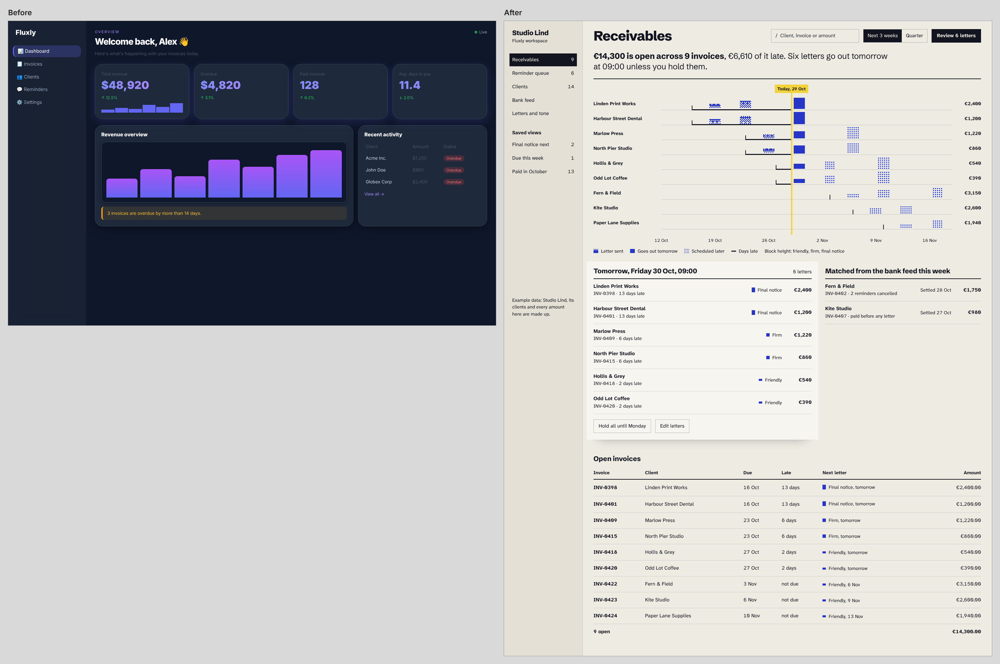

# unslopslop

A Claude Code skill for designing things that look like a strong studio made them for *this* project, with a detector that proves it in two numbers:

- **Slop score** (0 to 100; **100 is the worst**, the way the owner reads it): the worse of two things. (1) *Taste not proven*: 100 minus the **taste proof**, which a page has to earn with a real subject at 25-60% of the first screen, a display line of 80 px or more, deliberate overlap, one ground colour with accents under 3%, and no coloured headline keyword. (2) The genre-default tells (purple gradients, coloured keywords, icon tiles, identical card rows, cliche copy, fake social proof ...), which count less the more is proven. The other ~60 hygiene rules (small text, padding, tap targets, contrast ...) are reported but do not move this number.
- **Craft score** (0 to 100, higher is better): hierarchy, a focal point, a real visual, purposeful motion, identity (type, colour combination, depth, texture) and density that fits the page type.

A page passes only with **slop under 35, craft 70+ and taste proof 60+**, and stays **UNPROVEN** until a side-by-side compare against a strong reference was run (`detect.mjs --compared compare.png`). `--compared` is an attestation: the tool only checks that the file exists and does not verify that a real side-by-side look happened, so the human or agent passing it is vouching for it. Removing slop is not the goal: a beige document with a default serif scores zero slop and fails on craft, and the detector says why (`bland-*` signals). unslopslop removes slop **and** raises craft.

## Example

Two self-made slop pages for a made-up invoice-chasing tool, "Fluxly", each shown three times: the slop original, a first rewrite that only stripped things out (`after-v1`, kept on purpose because it is the opposite failure), and the rewrite done with the full loop. All names and numbers on the pages are samples.

The first version of this detector only counted known bad patterns, so a page that dodged the checklist but had no real subject scored 0 slop. The owner rejected our own "after" pages (and a consultancy homepage redesign) as just as bad as the originals. `tests/calibration/` now holds our own rejected pages with human labels next to derived measurements of strong reference pages (third-party pages are never stored in the repo; optional local copies are read from `UNSLOP_CALIBRATION_DIR` and `UNSLOP_GOLD_FILE`); the detector must put the rejected pages at 90+ slop and keep the strong ones passing. The example "after" pages below are being rebuilt and are not shown as passing.





The landing hero is a working demo written as a pure function of time: one invoice, a friendly letter on day 3, a firm one on day 7, payment on day 9, the day-14 notice cancelled. It plays once and rests; with reduced motion it shows the last frame. Stripped versus crafted: `examples/*/compare-v1-desktop.png`. Phone views: `compare-mobile.png`. Reports: `examples/<name>/<version>-report/`.

## Try it

Describe your project in one sentence. The agent will read the project, write a direction brief (mood, colour combination with roles, type pairing, texture, motion character, density, one signature move), load the right domain and style packs, build the first screen, run the detector, compare with the strongest reference, and iterate until slop is clean and craft passes.

> "A sleep timer app for night-shift nurses; the main screen and a landing page."

What happens: the project read gives *tired, careful, low light, one hand on the phone*. The brief picks a dusk combination (deep teal ground, sand text, one apricot accent for the start button), a rounded text face, a slow breathing ring as the single motion moment, a large start button in thumb reach, and dark-room contrast. The `mobile` pack sets 44 pt targets and a bottom action; the `web` pack builds the landing with the timer itself in the first screen. Then: detect, compare, fix, report both numbers with screenshots.

## What can it design?

| Domain | Pack | Status |
|---|---|---|
| Web pages (landing, marketing, portfolio) | `domains/web` | ready |
| Dashboards and app screens | `domains/dashboard` | ready |
| Mobile app UI | `domains/mobile` | early |
| Email (newsletter, transactional) | `domains/email` | early |
| Logo and brand identity | `domains/logo-brand` | early |
| Website and UI animation | `domains/motion` | early |
| Social and marketing visuals | `domains/social` | early |

The detector runs fully on web pages, app screens, mobile web and email HTML. Logo and native mobile checks are manual for now. *Early* packs are honest stubs that grow with each batch of references.

## Styles

Name a style and the skill loads it on top of the domain pack: `styles/retro-pixel` and `styles/ascii-text-art` (with a dependency-free demo) are complete; swiss-international, editorial-serif, brutalist, neo-brutalism, y2k-chrome, glass-aurora, bento, terminal-dev, memphis, japanese-minimal, organic-earthy, luxury-fashion, data-dense, claymorphism, risograph-print, playful-kids and zine-punk, blueprint-mono, pantry-bold and pop-ritual are early packs. Each pack lists its slop versions, so "retro pixel" done lazily is caught too.

## How it thinks

There is no house style. A meditation app, a fintech dashboard and a record label need different directions, and the first step is always to read the project. Colour is chosen in combinations, not single swatches.

**The story behind the colour method.** In the early 1930s, the Japanese painter and costume designer Sanzo Wada (1883-1967) set out to record the colour sensibility of his time in a six-volume work, *Haishoku Soukan*. Rather than listing single colours, he paired them in sets of two, three and four, so that every colour was always seen in company. A selection was later reissued in English and Japanese as *A Dictionary of Color Combinations*, which designers still treat as a quiet cult reference. Its lesson is simple: no colour is right or wrong alone, and meaning comes from the combination and its context. A hue that looks awkward by itself can be exactly right beside the right neighbour. unslopslop borrows this mindset, not the book's palettes. Like a cook who marinates the same chicken differently for each dish, the skill picks colours for the project in front of it instead of reaching for the same default gradient. We are inspired by Sanzo Wada and his work, and are not affiliated with his estate or publishers.

More in [`PHILOSOPHY.md`](PHILOSOPHY.md). Agents: [`AGENTS.md`](AGENTS.md).

## Install (Claude Code)

Requirements: Node 20+ and Playwright with Chromium on your machine (`npm i -g playwright && npx playwright install chromium`). unslopslop adds no dependencies.

```bash
git clone https://github.com/ruesandora/unslopslop
mkdir -p .claude/skills
cp -r unslopslop/skills/unslopslop .claude/skills/
```

Then ask: "design a landing page for …", "this dashboard looks generic, fix it", or "unslop `index.html`".

## Use the scripts directly

```bash
# both numbers for a page (file or URL); writes report.json, report.md, desktop.png, mobile.png
node skills/unslopslop/scripts/detect.mjs examples/saas-landing/after.html --out out/after

# CI: fail on heavy slop, or on craft below the pass mark
node skills/unslopslop/scripts/detect.mjs https://example.com --fail-on light --min-craft 70

# side by side (before/after, or yours next to a reference); --wait lets a one-shot demo finish
node skills/unslopslop/scripts/compare.mjs before.html after.html --wait 8000 --out compare.png

# timing of an animation
node skills/unslopslop/scripts/motion-probe.mjs page.html --trigger click:#go --sample "#panel"

# add a reference to the inspiration library (fonts, palette by area, motion timings, tags)
node skills/unslopslop/scripts/intake.mjs https://example.com --tags "domain:web, mood:calm"
```

Cookie and consent banners are hidden (never accepted) before rules run and screenshots are taken; `--keep-consent` keeps them.

## How the scores work

**Slop (owner reading, 100 is the worst):** `max(100 - taste proof, tells x (0.2 + 0.8 x (1 - proof/100)))`. Tells are the genre-default rules, weighted critical 12, major 6, minor 2 (extra occurrences +25% each, capped at twice). Verdict `heavy` at 35+, `clean` below 20 with no critical tell, otherwise `light`. Rule-only pattern slop is still reported as `patternScore`.

**Taste proof (0 to 100):** subject 30, display 25, overlap 15, ground 15, keyword 15. Caps: no real subject (a CSS box or a labelled data chart does not count) means at most 10; a display line under 80 px on a non-app page means at most 55. Pass mark 60. Measured on strong references (display 86-104 px) against template pages (mostly 48-72 px).

**Craft:** six components, hierarchy 15, focal 15, visual 20, motion 15, identity 20, density 15. Pass mark 70. App screens (a table on the first screen or a side navigation) are judged on density and a smaller type ratio. Full catalogue with fixes: `skills/unslopslop/references/rules.md`.

## Tests

```bash
npm test
```

Every slop rule and every bland rule has a bad and a good fixture. `tests/mutation.test.mjs` disables each rule in turn, and switches off each craft component in turn, and checks that exactly the matching test fails, so a passing suite means the fixtures really exercise the code. Bugs found while building the examples have regression tests, and the example reports are re-checked against the live pages.

## Limits

- Both numbers measure what can be measured: known tells, and the presence of qualities. They do not judge taste. A page can score 100 on craft and still be wrong for its project; always open the screenshots and compare with a strong reference.
- Rules are heuristics and can misfire on unusual markup. Disable one with `--disable rule-id` and say why.
- Pages are read after rendering; the source framework is not inspected. Audit a production build.
- Fonts that fail to load fall back silently; the typography rules read the declared family, the craft probe checks what actually loaded.

## License

MIT, see `LICENSE` (Copyright (c) 2026 Rueseo). The licence may change before 1.0. Bundled example fonts are under the SIL Open Font License (see `NOTICE`).
