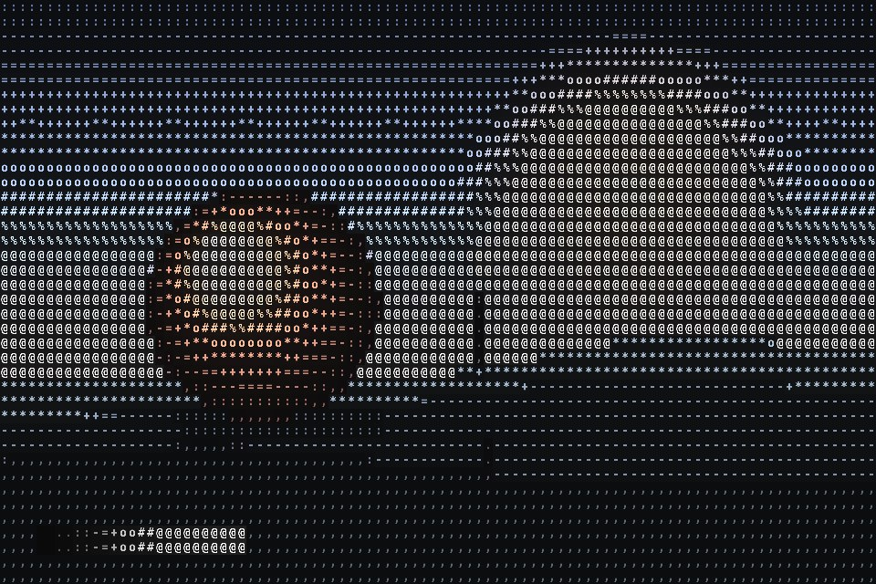

# ASCII render

The picture is sampled once per character cell and each cell prints a glyph from a light-to-heavy ramp, so brightness becomes type. Also as blocks, dots or vertical strokes.

Live demo: [`demo.html`](demo.html) (open the file in a browser; sliders change it live; "Your image" stays local).

| | |
|---|---|
| Group | Print and retro |
| Built with | WebGL 1 fragment shader (one pass) on the shared runtime |
| Fits | developer tools, terminal-themed launches, a hero image made of type |

## How it works

A glyph sheet of 12 characters ordered from light to heavy is drawn once into a hidden canvas from the system monospace font. The frame is cut into tall cells; each reads the image at its centre and picks the glyph whose weight matches the brightness. Blocks, dots and strokes replace the glyph with a shape whose size tracks brightness.

## Parameters

| Parameter | Range | Default |
|---|---|---|
| Cell width (px) | 4 to 40 | 10 |
| Cell height / width | 1 to 2.5 | 1.6 |
| Mark | Characters / Blocks / Dots / Strokes | Characters |
| Colour | Source colours / Palette ink | Source colours |
| Exposure | 0.5 to 3 | 1.5 |
| Background show-through | 0 to 1 | 0.08 |

## Performance

- Cost: One source read and one glyph read per pixel. Cheap. The glyph sheet is drawn once in a hidden canvas from the system monospace font.
- Mobile and fallback: No WebGL: the CSS gradient. A real-text version (a pre element filled from a canvas) is better for SEO and screen readers but costs layout; keep it under about 120 by 60 cells.
- Motion: Static.

## When to use

The product is software for builders, or type is the identity and a picture can be made of it.

## When it becomes slop

Green on black terminal cosplay for a product that is not a developer tool, or characters small enough that it reads as noise. The glyphs should be legible as glyphs.
