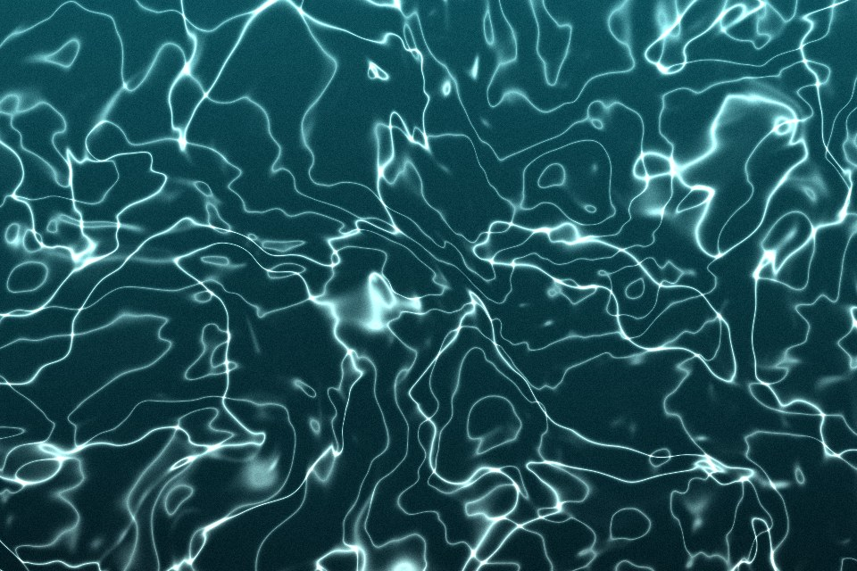

# Caustics

The bright web of light on the floor of a pool. Two warped noise fields are drawn as thin bright contour lines and the light pools where they cross. A second pattern builds the web from moving cell edges instead.

Live demo: [`demo.html`](demo.html) (open the file in a browser; sliders change it live; "Your image" stays local).

| | |
|---|---|
| Group | Light and colour |
| Built with | WebGL 1 fragment shader (one pass) on the shared runtime |
| Fits | water, glass, drinks, skincare and pool brands; a hero background |

## How it works

Curved mode: two noise fields, both warped by a third, are turned into thin bright lines where a sine of their value crosses zero; where the two line sets meet, light pools. Cell mode: the edge between the nearest and second-nearest moving point (cell noise) becomes a bright line.

## Parameters

| Parameter | Range | Default |
|---|---|---|
| Cell scale | 2 to 20 | 6 |
| Line width | 0.02 to 0.4 | 0.32 |
| Brightness | 0 to 2 | 1.1 |
| Second layer | 0 to 1 | 0.55 |
| Pattern | Curved webs / Cell edges | Curved webs |
| Speed | 0 to 2 | 0.5 |
| Grain | 0 to 0.3 | 0.05 |

## Performance

- Cost: Two cell-noise layers, 9 neighbours each, per pixel. Medium. 30 fps cap; on phones one layer and a lower DPR are fine.
- Mobile and fallback: No WebGL: the CSS gradient. Reduced motion: one still frame, which still reads as water.
- Motion: 30 fps; still frame under reduced motion.

## When to use

The subject is water or light through glass.

## When it becomes slop

Bright white lines at full strength behind content, or caustics on a brand with no water, light or glass story.
