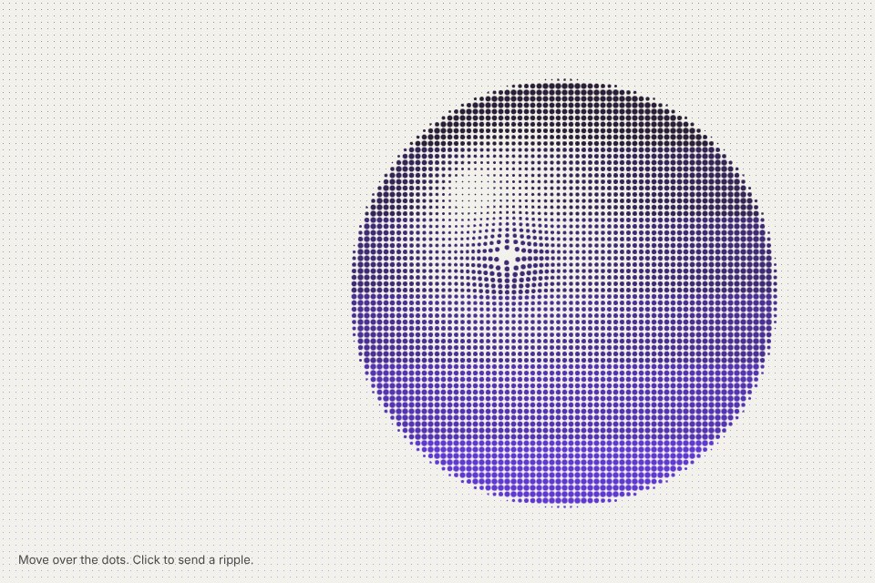

# Dot lens

A dot screen that reacts: a lens under the pointer swells and pushes the dots on springs, a click sends a ripple through them. Empty paper keeps a faint second screen.

Live demo: [`demo.html`](demo.html) (open the file in a browser; move the pointer and click; "Your image" stays local).

| | |
|---|---|
| Group | Print and retro |
| Built with | Canvas 2D, one spring per dot, fixed-step integration (no WebGL) |
| Fits | a product or mark drawn in dots, a hero that rewards the pointer, an interactive empty state |

## How it works

The source is drawn at one pixel per cell and read once. Each dot keeps its home position, a size from darkness (square root, so area follows tone) and an offset on a spring. Under the pointer a smooth lens raises the size and sets an outward target offset; the springs (stiffness 1600, damping 68, 8 ms steps) carry the dots there and back without a visible bounce. A click adds a ring that grows at 0.75 px per ms and pushes the dots it crosses for about 400 ms. Paper areas draw a much smaller, fainter screen so the grid stays visible. The loop sleeps when every spring is at rest.

## Parameters

| Parameter | Range | Default |
|---|---|---|
| Cell (px) | 4 to 16 | 7 |
| Lens radius (px) | 0 to 160 | 70 |
| Lens swell | 0 to 1.5 | 0.6 |
| Lens push (px) | 0 to 16 | 5 |
| Ripple push (px) | 0 to 16 | 6 |
| Paper screen | 0 to 0.5 | 0.18 |
| Source | lit sphere / large letter / horizon / your image | lit sphere |
| Palette | ink on paper / signal on night / moss on linen | ink on paper |

## Performance

- Cost: one arc per dot per frame while something moves, nothing at rest. About 26 000 dots at 1440 x 900 and 7 px; use 9 px or more on phones.
- Mobile and fallback: touch works through pointer events; with no canvas the section shows its background colour.
- Motion: only in answer to the pointer. Reduced motion draws one still frame and ignores the pointer until Play is pressed.

## When to use

The brief has a print or signal character and the dots draw something real: the product, the mark, a portrait. One field per page, in the hero or an empty state.

## When it becomes slop

The dots draw nothing in particular (a dot sphere because dot spheres are popular), the lens is on every card, or the field sits behind body text.
