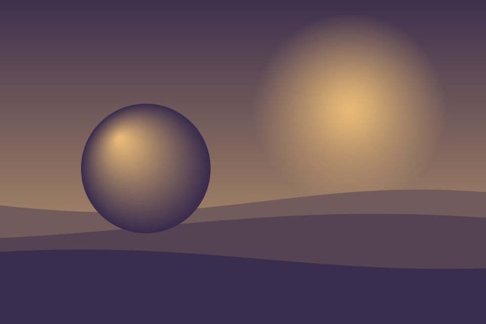

# Duotone

Any photo mapped to two inks with one SVG filter.

Live demo: [`demo.html`](demo.html) (open the file in a browser; sliders change it live; "Your image" stays local).

| | |
|---|---|
| Group | Image treatment |
| Built with | One inline SVG filter applied with CSS |
| Fits | card images, team or customer photos of mixed quality, editorial grids |

## How it works

An SVG filter converts the image to luminance, then a three-entry colour table per channel maps black, mid grey and white to the shadow ink, a mid mix and the highlight ink.

## Parameters

| Parameter | Range | Default |
|---|---|---|
| Shadow ink | any colour | #1b1446 |
| Highlight ink | any colour | #f2c27a |
| Midtone push | 0.2 to 0.8 | 0.5 |

## Performance

- Cost: Two filter primitives per image, cheap even on a grid of cards.
- Mobile and fallback: Old browsers show the photo in colour.
- Motion: Static.

## When to use

Many photos from different sources must look like one set, in the project palette.

## When it becomes slop

Pink-and-blue by default, or on product photos where real colour matters.
