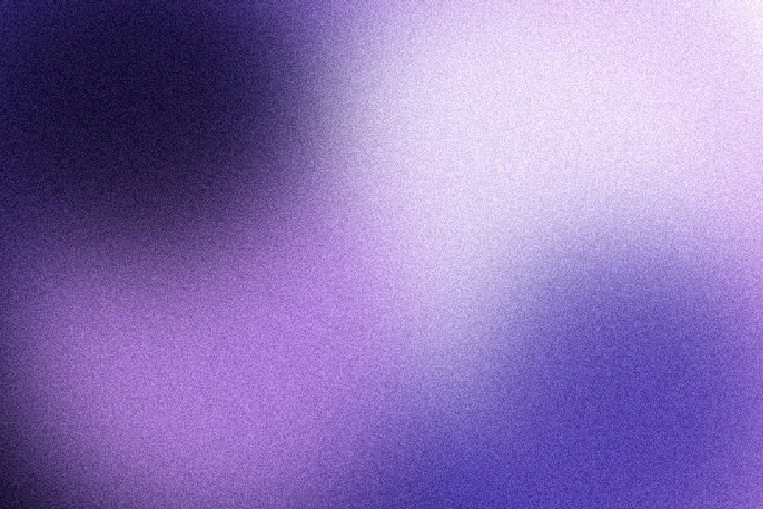

# Film grain

Fine per-pixel noise added as the very last step. It breaks up gradient banding, gives flat colour a material, and flickers slightly when motion is on. Drag the split to compare with and without.

Live demo: [`demo.html`](demo.html) (open the file in a browser; sliders change it live; "Your image" stays local).

| | |
|---|---|
| Group | Finish |
| Built with | WebGL 1 fragment shader (one pass) on the shared runtime |
| Fits | any gradient or flat hero, image treatments, section textures |

## How it works

Each pixel gets the sum of two hashed random values (a triangle-shaped distribution, softer than plain white noise), weighted so midtones get more than pure blacks and whites. The hash is re-seeded 24 times a second when motion is on.

## Parameters

| Parameter | Range | Default |
|---|---|---|
| Amount | 0 to 0.3 | 0.12 |
| Grain size | 1 to 4 | 1.4 |
| Colour noise | 0 to 1 | 0.15 |
| Compare split (0 = all grain) | 0 to 1 | 0.0 |

## Performance

- Cost: Two hashes per pixel, the cheapest effect here. For a static page the CSS grain overlay (grain-overlay) is cheaper still: no canvas at all.
- Mobile and fallback: No WebGL: the CSS gradient. Reduced motion: the grain is still there, it just stops flickering.
- Motion: Flicker at 24 fps; under reduced motion it renders one still frame with the grain kept.

## When to use

A gradient bands on a big screen, flat colour feels plastic, or a hero needs a material without a new colour.

## When it becomes slop

Amount above about 0.15 on text-heavy pages (it reads as dirt), coloured grain on brand colours, or grain over a UI screenshot that should look crisp.
