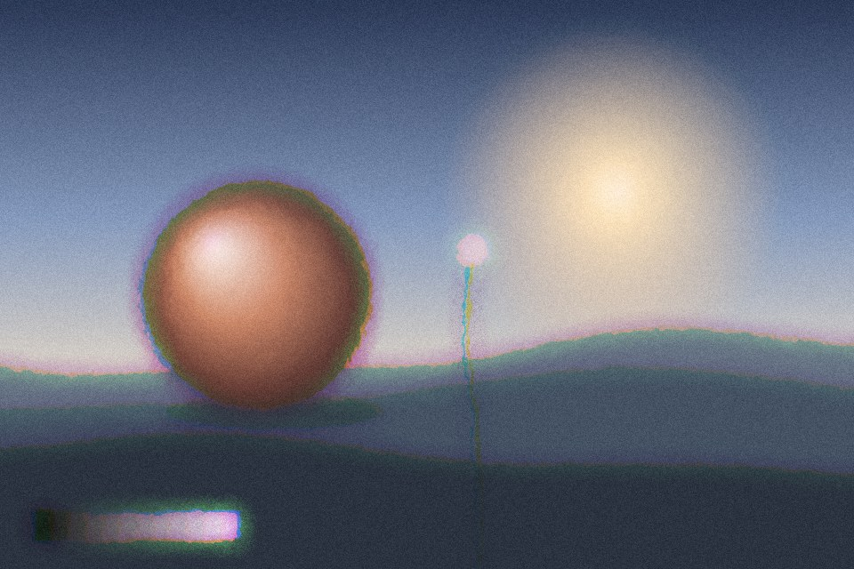

# Frosted glass

Hand-poured glass with no grid: a smooth noise field bends the picture, then a small jittered blur softens it. Panel mode limits it to one rounded pane so the sharp scene stays around it.

Live demo: [`demo.html`](demo.html) (open the file in a browser; sliders change it live; "Your image" stays local).

| | |
|---|---|
| Group | Glass |
| Built with | WebGL 1 fragment shader (one pass) on the shared runtime |
| Fits | one hero visual, a single pane over a photo, card media |

## How it works

A smooth multi-octave noise field is treated as a height map; its slope (central differences) offsets the sample position, so the picture bends without a grid. Then 12 samples on a jittered spiral blur it. Red and blue are bent slightly differently for a soft fringe. Pane mode masks it to a rounded rectangle with a lit rim.

## Parameters

| Parameter | Range | Default |
|---|---|---|
| Refraction | 0 to 1 | 0.35 |
| Bump scale | 1 to 40 | 26 |
| Roughness | 0 to 1 | 0.6 |
| Blur | 0 to 1 | 0.6 |
| Colour fringe | 0 to 1 | 0.2 |
| Area | Whole frame / One pane | Whole frame |
| Grain | 0 to 0.3 | 0.06 |

## Performance

- Cost: Nine texture reads per pixel plus noise. Medium. On phones keep it to one pane, or use the CSS backdrop-filter version (frosted-panel).
- Mobile and fallback: No WebGL: the CSS gradient. For UI panes prefer backdrop-filter, with a solid tinted fill where it is unsupported.
- Motion: Static.

## When to use

You need a soft, diffused look over a real scene and one pane is enough. For UI panes prefer frosted-panel (CSS).

## When it becomes slop

Every card is frosted, it floats over a purple-blue blob, or text sits on it below 4.5:1 contrast. One frosted surface per screen at most.
