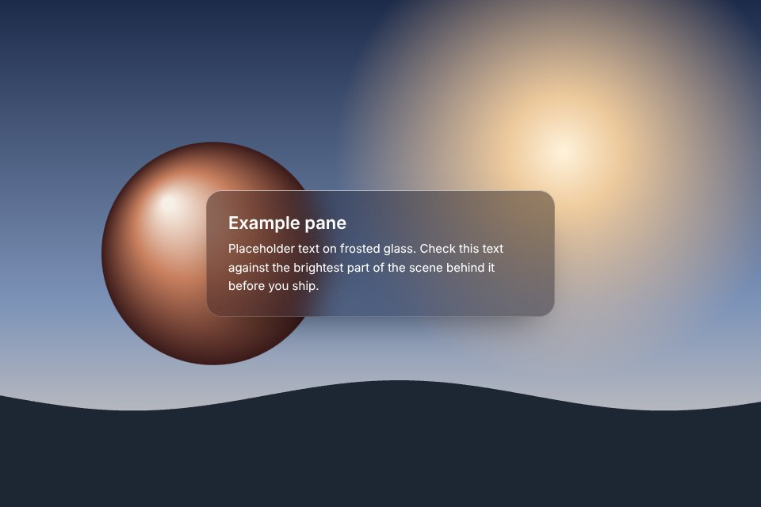

# Frosted panel

One frosted pane over a real scene in CSS only, with a lit rim, fine noise and a solid fallback.

Live demo: [`demo.html`](demo.html) (open the file in a browser; sliders change it live; "Your image" stays local).

| | |
|---|---|
| Group | Glass |
| Built with | CSS and SVG only, no canvas |
| Fits | one floating pane over a hero photo, a media caption, a sign-up box over a scene |

## How it works

backdrop-filter blurs and saturates whatever is behind the pane; a dark translucent fill keeps text readable; two inset shadows draw a lit top rim and a faint edge line; a noise tile at low opacity removes the plastic look. @supports swaps in a near-opaque fill when the property is missing.

## Parameters

| Parameter | Range | Default |
|---|---|---|
| Blur (px) | 0 to 48 | 18 |
| Dark tint | 0 to 0.8 | 0.42 |
| Saturation boost | 1 to 2 | 1.4 |

## Performance

- Cost: backdrop-filter repaints under the pane when the backdrop moves; one pane is fine, a frosted sticky header over scrolling content is not cheap on low-end phones.
- Mobile and fallback: @supports gives a near-opaque tinted fill.
- Motion: Static.

## When to use

The scene behind the pane is the point (a photo, a product), and only one pane is frosted.

## When it becomes slop

Every card frosted, over a purple-blue blob, or text under 4.5:1 against the brightest spot behind. The detector flags frosted glass as a default move.
