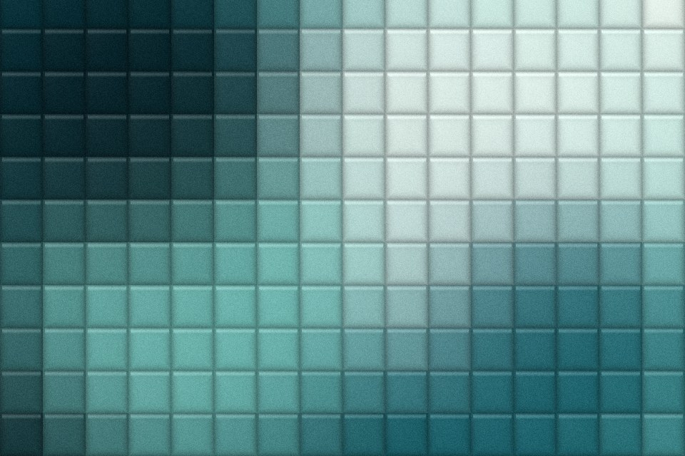

# Glass tiles

A wall of square glass blocks. Every tile is a small two-way prism that shows its own shifted, slightly magnified piece of the picture, with a dark seam and a lit top edge.

Live demo: [`demo.html`](demo.html) (open the file in a browser; sliders change it live; "Your image" stays local).

| | |
|---|---|
| Group | Glass |
| Built with | WebGL 1 fragment shader (one pass) on the shared runtime |
| Fits | hero backgrounds, architectural or bathroom-material brands, card media |

## How it works

Square cells in aspect-correct space. Each cell offsets its sample towards its own centre in both axes, which magnifies a piece of the picture per tile. A small cross blur softens it, the seam darkens with the sixth power of the distance to the edge, and a top edge catches light.

## Parameters

| Parameter | Range | Default |
|---|---|---|
| Tiles across | 3 to 40 | 16 |
| Refraction | 0 to 1 | 0.6 |
| Softness | 0 to 1 | 0.35 |
| Seam shadow | 0 to 1 | 0.3 |
| Edge light | 0 to 1 | 0.3 |
| Grain | 0 to 0.3 | 0.05 |

## Performance

- Cost: Five texture reads per pixel. Cheap and static.
- Mobile and fallback: No WebGL: the CSS gradient. A CSS approximation is a background-size grid of inset shadows over a blurred image.
- Motion: Static.

## When to use

You want a glass-block material, or ribbed glass feels too directional.

## When it becomes slop

Tiles under about 24 px (it turns into a screen-door), or used behind text.
