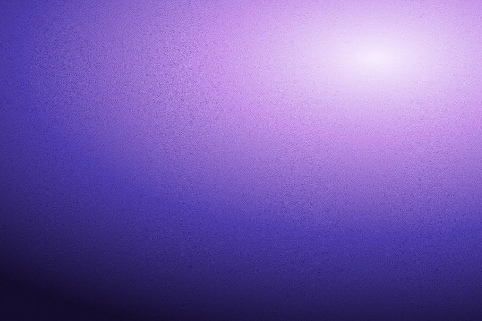

# Grain overlay

Film grain with no canvas: an SVG turbulence tile laid over a section with a blend mode.

Live demo: [`demo.html`](demo.html) (open the file in a browser; sliders change it live; "Your image" stays local).

| | |
|---|---|
| Group | Finish |
| Built with | CSS and SVG only, no canvas |
| Fits | whole sections, gradient heroes, CSS-only sites, email-safe hero images (export) |

## How it works

An SVG fractal-noise filter is drawn into a 240 px tile, desaturated and pushed in contrast, then used as the background of one ::after layer with a blend mode. The optional flicker moves that layer in four steps; it never repaints.

## Parameters

| Parameter | Range | Default |
|---|---|---|
| Amount (opacity) | 0 to 0.6 | 0.3 |
| Grain fineness | 0.3 to 1.6 | 0.9 |
| Tile scale | 0.4 to 2 | 0.85 |
| Blend mode | overlay / soft-light / multiply / screen | overlay |

## Performance

- Cost: Close to free: a few hundred bytes of SVG rasterised once; the optional flicker is a composited transform.
- Mobile and fallback: None needed; SVG filters in data URIs work everywhere current.
- Motion: Flicker is off by default and removed under reduced motion.

## When to use

The page has no canvas budget, or you want grain on many sections at no runtime cost.

## When it becomes slop

Opacity high enough that text looks dirty, flicker on every section, or grain over photos that already have it.
