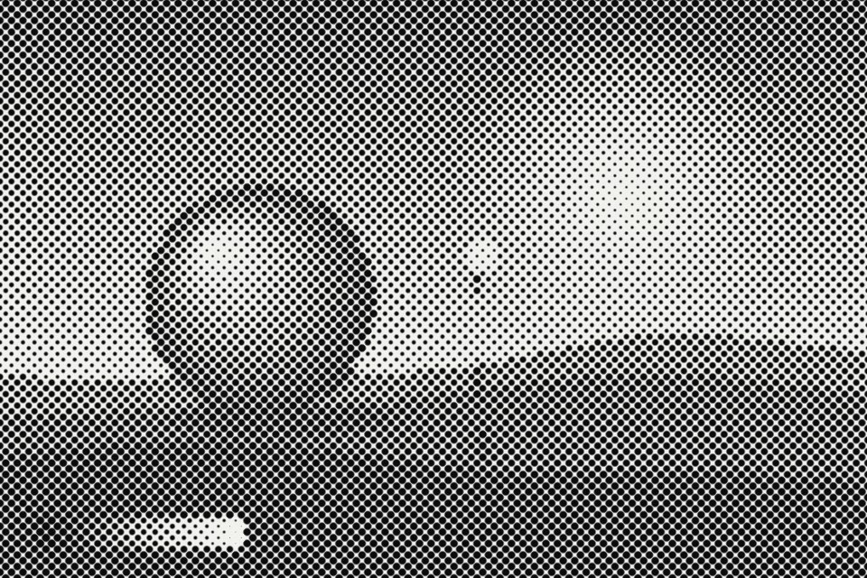

# Halftone

A rotated print screen: each cell reads the brightness under it and draws a dot (or line, or square) whose size carries the tone. Ink on paper, or dots in the source colours.

Live demo: [`demo.html`](demo.html) (open the file in a browser; sliders change it live; "Your image" stays local).

| | |
|---|---|
| Group | Print and retro |
| Built with | WebGL 1 fragment shader (one pass) on the shared runtime |
| Fits | hero photos, editorial and print-led brands, section textures |

## How it works

The frame is rotated by the screen angle and cut into cells. Each cell reads the image at its centre; darkness sets the size of a dot (square root so area tracks tone), a line, a square or a ring. Edges are antialiased by one pixel. Ink and paper colours come from the palette, or ink takes the source colour.

## Parameters

| Parameter | Range | Default |
|---|---|---|
| Cell (px) | 3 to 40 | 9 |
| Screen angle | 0 to 90 | 45 |
| Dot scale | 0.2 to 1.4 | 1.0 |
| Mark | Dots / Lines / Squares / Rings | Dots |
| Colour | Ink on paper / Source colours | Ink on paper |
| Paper | 0 to 1 | 1 |
| Grain | 0 to 0.3 | 0.03 |

## Performance

- Cost: One texture read and a distance test per pixel. Cheap. Cell size is in CSS pixels so the screen ruling stays the same at any size.
- Mobile and fallback: No WebGL: the CSS gradient. For a fixed pattern over any image, a CSS radial-gradient dot grid with mix-blend-mode multiply gets halfway.
- Motion: Static.

## When to use

Print, paper or editorial is in the brief, or photos of mixed quality need one shared treatment.

## When it becomes slop

Huge dots on a small card, cyan-magenta-yellow on a brand that never prints, or halftone plus dither plus grain together.
