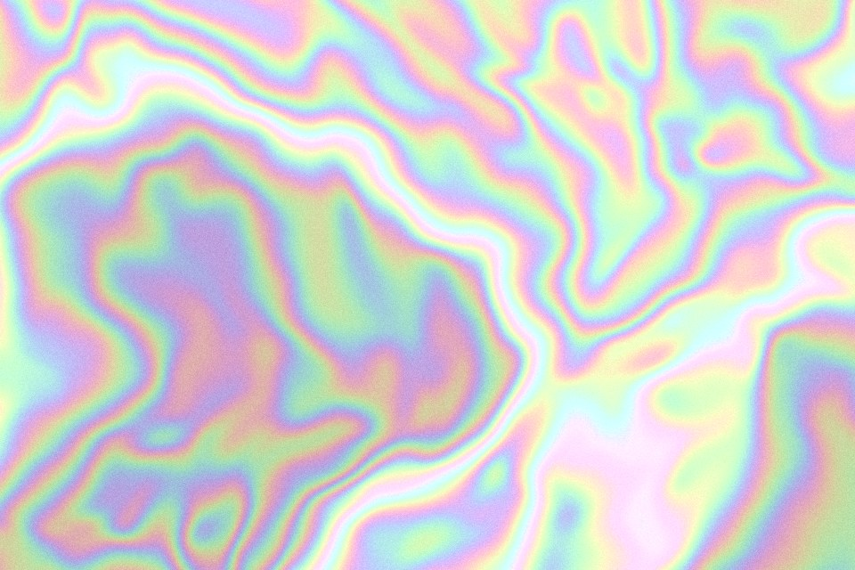

# Iridescence

An oil-film sheen: a slowly warped thickness field is turned into colour with a cosine rainbow, so hues shift in thin bands like soap or holographic foil. Mix it back over the palette to keep it quiet.

Live demo: [`demo.html`](demo.html) (open the file in a browser; sliders change it live; "Your image" stays local).

| | |
|---|---|
| Group | Light and colour |
| Built with | WebGL 1 fragment shader (one pass) on the shared runtime |
| Fits | one object or one band: cosmetics, packaging foil, holographic cards |

## How it works

A warped noise field is treated as film thickness. A cosine rainbow of that thickness gives thin hue bands, lightened toward pastel and mixed over the palette ramp; a narrow ridge adds a specular line.

## Parameters

| Parameter | Range | Default |
|---|---|---|
| Band frequency | 0.5 to 16 | 5 |
| Warp | 0 to 3 | 0.9 |
| Scale | 0.3 to 5 | 1.5 |
| Sheen over palette | 0 to 1 | 0.6 |
| Flow | 0 to 1 | 0.25 |
| Grain | 0 to 0.3 | 0.05 |

## Performance

- Cost: Two noise layers and a cosine per pixel. Light to medium. 30 fps cap.
- Mobile and fallback: No WebGL: the CSS gradient. A conic-gradient with a blur filter is a weak but static CSS stand-in.
- Motion: 30 fps; still frame under reduced motion.

## When to use

A foil, pearl or soap-film material is in the brief.

## When it becomes slop

Full-strength rainbow over the whole page (y2k sticker), or on text. Keep it on one object or one band, mixed under 50 percent.
