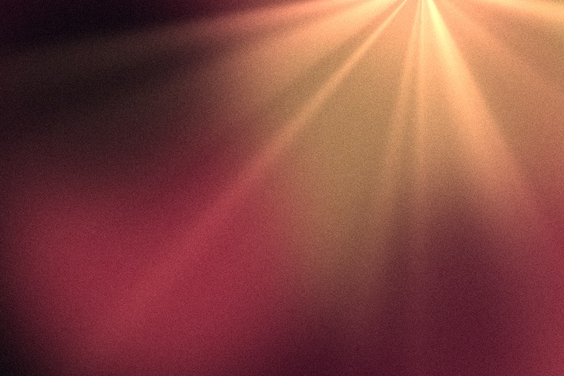

# Light rays

Beams fanning out from one source point, like sun through haze. Ray strength comes from smooth noise around the source, so the beams have uneven widths and drift slowly.

Live demo: [`demo.html`](demo.html) (open the file in a browser; sliders change it live; "Your image" stays local).

| | |
|---|---|
| Group | Light and colour |
| Built with | WebGL 1 fragment shader (one pass) on the shared runtime |
| Fits | hero backgrounds behind a product, launch moments, a section transition |

## How it works

The angle around a source point feeds a 1-D noise at the chosen beam count, so beams have uneven widths. Strength falls off exponentially with distance, and a small glow sits on the source. The noise slides slowly over time.

## Parameters

| Parameter | Range | Default |
|---|---|---|
| Beam count | 4 to 80 | 26 |
| Intensity | 0 to 1.5 | 0.75 |
| Reach | 0.1 to 2 | 0.9 |
| Source glow | 0 to 1 | 0.5 |
| Source X | -0.2 to 1.2 | 0.75 |
| Source Y | -0.2 to 1.2 | 1.05 |
| Drift | 0 to 1 | 0.25 |
| Grain | 0 to 0.3 | 0.08 |

## Performance

- Cost: Two noise calls per pixel. Light. Animated at 30 fps; still frame under reduced motion.
- Mobile and fallback: No WebGL: the CSS gradient. A conic-gradient with repeating thin stops and a radial mask is a passable static CSS version.
- Motion: 30 fps; still frame under reduced motion.

## When to use

There is a real light source in the story (sunrise, a lamp, a product glow).

## When it becomes slop

A sunburst behind a product shot (it reads as a clip-art reveal), or rays plus glow plus lens flare together.
