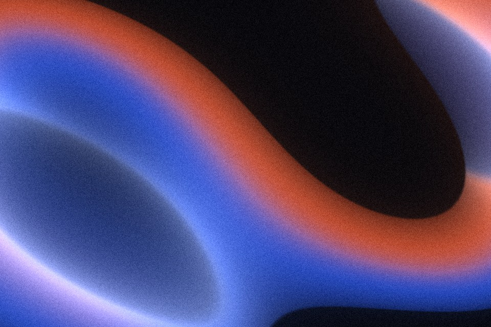

# Light ribbon

One folded sheet of light crossing a dark void. The sheet splits into a cool edge and a warm edge like light through a prism, and brightens where it folds. Built for a cover or a hero with a large title on top.

Live demo: [`demo.html`](demo.html) (open the file in a browser; sliders change it live).

| | |
|---|---|
| Group | Light and colour |
| Built with | WebGL 1 fragment shader (one pass) on the shared runtime |
| Fits | brand-book covers, a launch hero with one large title, section dividers on dark pages |

## How it works

The sheet is every point whose height, after a smooth wave bend, sits inside a band. Where the band is seen edge-on (the height barely changes as you move up) the sheet is folding: that spot gets the highlight colour. Where the bend turns the sheet over, its back shows in a darker, cooler tone. Across its width the sheet runs from the cool colour to the warm colour; the prism split sets how sharp that change is. Outside the band is the void colour with a faint halo. Grain goes on last.

Palette roles: void (most of the frame), cool edge, warm edge, highlight. A good proportion is roughly 40 to 55 percent void, 25 percent cool, 15 percent warm, under 5 percent highlight.

## Parameters

| Parameter | Range | Default |
|---|---|---|
| Sheet width | 0.05 to 1.2 | 0.6 |
| Fold depth | 0 to 2.5 | 1.9 |
| Prism split | 0 to 1 | 0.6 |
| Fold light | 0 to 2 | 0.9 |
| Edge softness | 0.002 to 0.2 | 0.012 |
| Tilt | -1.2 to 1.2 | -0.35 |
| Flow | 0 to 1 | 0.3 |
| Grain | 0 to 0.3 | 0.09 |

## Performance

- Cost: A few sines and two samples of the same field per pixel; no texture reads. Light. Animated at 30 fps; one still frame under reduced motion.
- Mobile and fallback: No WebGL: the CSS gradient. A still frame exported as WebP (1600 px, about 120 KB with grain) is the zero-script version.
- Motion: Slow flow; a still frame is often enough for a cover.

## When to use

The brief is about light, signal, clarity or a split of two forces, and the page is dark. Put the title in the void, never across the brightest fold. The same frame reused as the cover, as a crop behind the logo and as a thin band between sections makes a system out of one image.

## When it becomes slop

Used as a generic purple-blue screensaver behind every section, or with the void removed so the whole frame is colour. The dark void is half the effect: keep at least a third of the frame empty.
