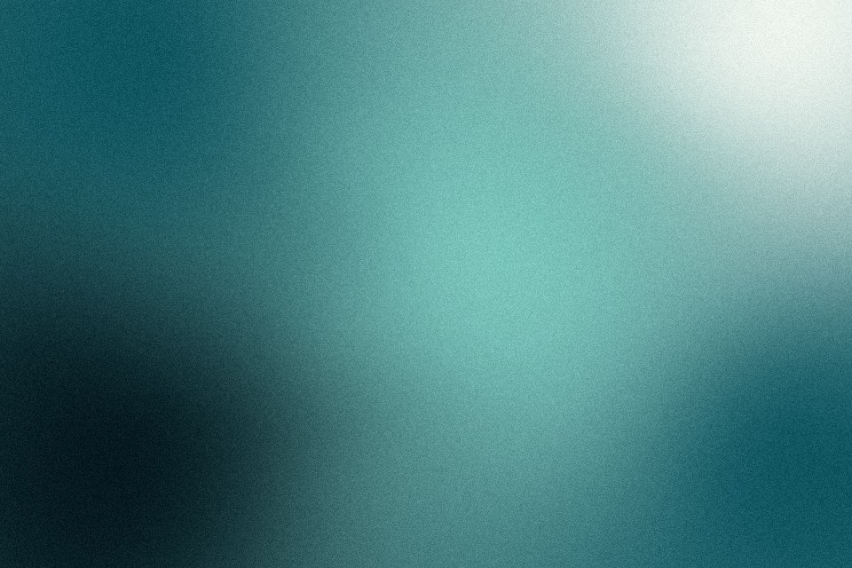

# Mesh gradient

Five colour points (four near the corners, one pooled near the middle) blended by distance, then gently bent with low-frequency noise so no edge is straight. The points drift slowly when motion is on.

Live demo: [`demo.html`](demo.html) (open the file in a browser; sliders change it live; "Your image" stays local).

| | |
|---|---|
| Group | Light and colour |
| Built with | WebGL 1 fragment shader (one pass) on the shared runtime |
| Fits | hero backgrounds, app splash, card media for abstract topics |

## How it works

Five control points (four near the corners, one in the middle) each carry a palette colour. Every pixel mixes them with inverse-distance weights raised to a softness power. Before that, the coordinates are bent by low-frequency noise so no transition is straight. The points orbit slowly.

## Parameters

| Parameter | Range | Default |
|---|---|---|
| Blend softness | 0.5 to 4 | 2.2 |
| Warp | 0 to 1 | 0.35 |
| Centre pool | 0 to 1 | 0.6 |
| Drift | 0 to 1 | 0.3 |
| Grain | 0 to 0.3 | 0.07 |

## Performance

- Cost: Five distance terms and two noise calls per pixel. Light. Cap it at 30 fps or render once; a still mesh looks the same.
- Mobile and fallback: No WebGL: the CSS gradient. Four stacked radial-gradients on one element are a close CSS-only version for static pages.
- Motion: 30 fps; still frame under reduced motion.

## When to use

A calm colour field is the right background and something sits on top of it.

## When it becomes slop

Purple to blue to pink with nothing on top, used as the whole hero. A mesh needs a subject, type or a texture over it, and colours chosen for the project.
