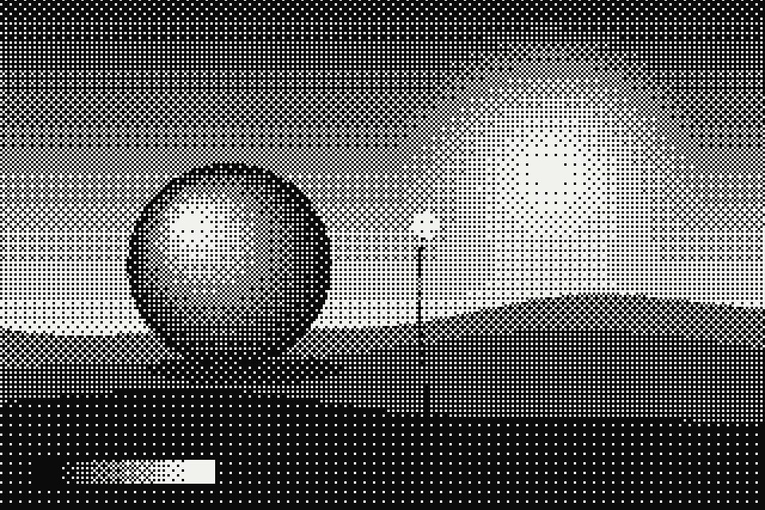

# Ordered dither

Colour is cut down to a few levels, and a fixed threshold pattern decides which pixels round up or down, so tone becomes a texture of dots. Pick the classic 2, 4 or 8 matrix, or an even noise pattern, and map the result to the palette.

Live demo: [`demo.html`](demo.html) (open the file in a browser; sliders change it live; "Your image" stays local).

| | |
|---|---|
| Group | Print and retro |
| Built with | WebGL 1 fragment shader (one pass) on the shared runtime |
| Fits | one hero image, a section texture, a 1-bit illustration style |

## How it works

Colour is quantised to N levels. Before rounding, a threshold from a fixed matrix is added: the 2 x 2 base pattern, and the 4 x 4 and 8 x 8 patterns built by stacking the base pattern at half and quarter resolution. The even-noise option uses a cheap low-discrepancy formula instead of a matrix. Cells are measured in CSS pixels. Luma mode maps the result through the palette ramp.

## Parameters

| Parameter | Range | Default |
|---|---|---|
| Pattern | Matrix 2 x 2 / Matrix 4 x 4 / Matrix 8 x 8 / Even noise | Matrix 4 x 4 |
| Dot size (px) | 1 to 12 | 3 |
| Levels | 2 to 16 | 2 |
| Strength | 0 to 1 | 1 |
| Colour | Palette ramp / Source colours | Palette ramp |
| Contrast | 0.5 to 2 | 1.15 |

## Performance

- Cost: A few arithmetic steps per pixel, one texture read. Cheap. Pattern cells are in CSS pixels so it looks the same on every screen.
- Mobile and fallback: No WebGL: the CSS gradient. A static PNG export of the same pattern is a fine fallback because dither does not animate.
- Motion: Static.

## When to use

The brief wants a 1-bit, newsprint or early-computer character, or a texture that is visibly made rather than smooth.

## When it becomes slop

Retro for its own sake on a calm brand, or dither on photos of people (faces turn to noise). Works best on one hero image or one texture band.
