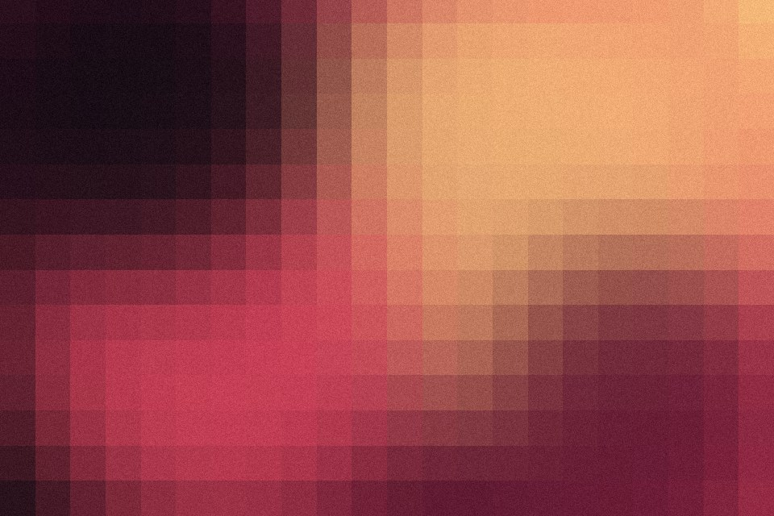

# Pixel mosaic

Square blocks sampled from their centres, crisp edges, no blur. Add a gap and round the corners and it becomes an LED wall or a bead grid.

Live demo: [`demo.html`](demo.html) (open the file in a browser; sliders change it live; "Your image" stays local).

| | |
|---|---|
| Group | Print and retro |
| Built with | WebGL 1 fragment shader (one pass) on the shared runtime |
| Fits | hero images, game and toy brands, LED or signage stories, a loading state |

## How it works

Coordinates snap to square blocks along the long edge; each block reads the image at its centre. Optional colour steps posterise. Gap and corner round turn blocks into beads or LEDs with a rounded-box distance test.

## Parameters

| Parameter | Range | Default |
|---|---|---|
| Blocks on long edge | 4 to 160 | 22 |
| Gap | 0 to 0.6 | 0 |
| Corner round | 0 to 1 | 0 |
| Colour steps (0 = off) | 0 to 12 | 0 |
| Grain | 0 to 0.3 | 0.06 |

## Performance

- Cost: One texture read per pixel. The cheapest image treatment here.
- Mobile and fallback: No WebGL: the CSS gradient. A small image scaled up with image-rendering: pixelated gives the plain version with no script at all.
- Motion: Static.

## When to use

You want an obviously digital material, or a low-resolution preview that resolves later.

## When it becomes slop

Blocks so big the subject is gone, or the LED look on a brand with no screen or signage story.
