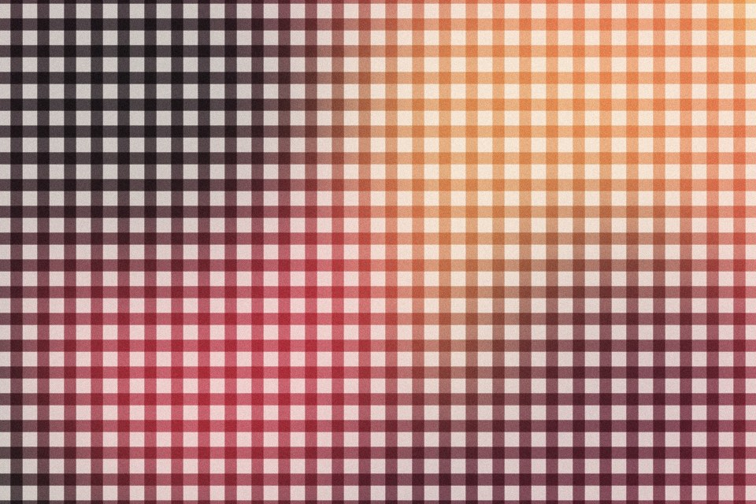

# Plaid weave

Rows and columns of colour bands laid over each other and multiplied, so crossings get darker, like woven cloth. Each band takes its colour from the picture at its centre, so a centred glow stays a glow.

Live demo: [`demo.html`](demo.html) (open the file in a browser; sliders change it live; "Your image" stays local).

| | |
|---|---|
| Group | Pattern |
| Built with | WebGL 1 fragment shader (one pass) on the shared runtime |
| Fits | fashion and textile brands, packaging, section backgrounds |

## How it works

Rotated row and column bands. Each band takes the colour of the image at its own centre line, so a radial gradient underneath becomes a glow in the cloth. Bands multiply over a paper colour (cloth) or screen over a dark ground (light lattice).

## Parameters

| Parameter | Range | Default |
|---|---|---|
| Band pitch (px) | 6 to 120 | 34 |
| Band width | 0.05 to 1 | 0.45 |
| Column strength | 0 to 1 | 0.7 |
| Row strength | 0 to 1 | 0.7 |
| Angle | -45 to 45 | 0 |
| Paper | 0 to 1 | 0.8 |
| Blend | Multiply (cloth) / Screen (light) | Multiply (cloth) |
| Grain | 0 to 0.3 | 0.05 |

## Performance

- Cost: Two texture reads per pixel. Cheap and static.
- Mobile and fallback: No WebGL: the CSS gradient. Two repeating-linear-gradients at 0 and 90 degrees with mix-blend-mode multiply make the mono version in pure CSS.
- Motion: Static.

## When to use

There is a textile, heritage or pattern story.

## When it becomes slop

Tartan as decoration on a brand with no textile, picnic or heritage story, or bands so dense they shimmer.
