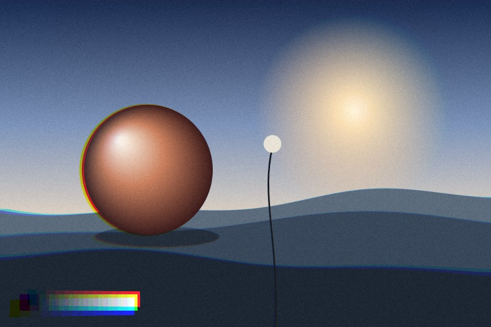

# RGB split

The red and blue channels slide apart from green, growing toward the edges like a cheap lens. Glitch mode shifts thin horizontal bands sideways instead.

Live demo: [`demo.html`](demo.html) (open the file in a browser; sliders change it live; "Your image" stays local).

| | |
|---|---|
| Group | Optics |
| Built with | WebGL 1 fragment shader (one pass) on the shared runtime |
| Fits | photo heroes, music and nightlife, a short glitch moment on a state change |

## How it works

Red is read from a point pushed outward, blue from a point pushed inward, green stays. In lens mode the push grows with the distance from the centre raised to a power. In glitch mode, a random subset of horizontal bands jumps sideways and the split widens there, re-rolled 8 times a second.

## Parameters

| Parameter | Range | Default |
|---|---|---|
| Split | 0 to 1 | 0.65 |
| Edge weighting | 0 to 3 | 1.6 |
| Mode | Lens (radial) / Glitch bands | Lens (radial) |
| Glitch bands | 4 to 120 | 36 |
| Grain | 0 to 0.3 | 0.05 |

## Performance

- Cost: Three texture reads per pixel. Cheap. Glitch mode animates; keep it to a short moment, not a loop.
- Mobile and fallback: No WebGL: the CSS gradient. A CSS cousin: two copies of an image with mix-blend-mode screen, tinted red and cyan, offset by 2 px.
- Motion: Glitch mode animates at 30 fps; still frame under reduced motion.

## When to use

A photo needs a lens character, or an event (an error, a drop) earns one short glitch.

## When it becomes slop

On text, on logos, or as a permanent loop. Fringes over 4 px on a sharp UI read as a bug.
