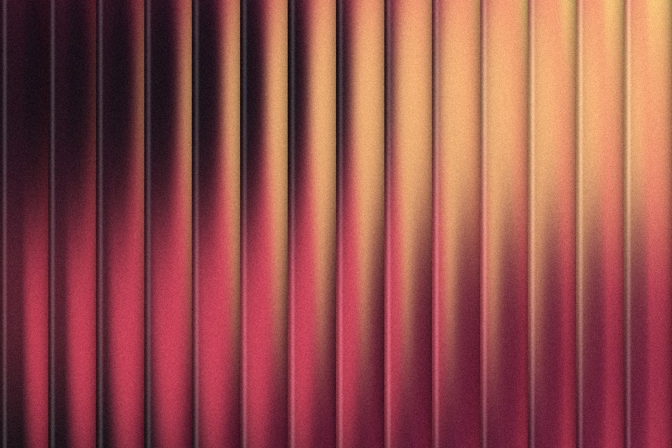

# Ribbed glass

The picture seen through vertical glass flutes: each rib is a small cylinder lens that squeezes and shifts its slice, with a dark groove and a bright edge between ribs.

Live demo: [`demo.html`](demo.html) (open the file in a browser; sliders change it live; "Your image" stays local).

| | |
|---|---|
| Group | Glass |
| Built with | WebGL 1 fragment shader (one pass) on the shared runtime |
| Fits | hero backgrounds, card media, product shots behind glass, section dividers |

## How it works

The frame is cut into ribs. Inside each rib the sample position is shifted by a prism term (linear across the rib) plus a little cylinder term (a sine), so every rib shows a squeezed, shifted window of the picture. A 5-tap blur runs across the rib only. The groove darkens with the fourth power of the distance from the rib centre, and a thin bright line sits near one edge. Red and blue are read a little apart for a fringe.

## Parameters

| Parameter | Range | Default |
|---|---|---|
| Ribs across | 4 to 60 | 14 |
| Refraction | 0 to 1 | 0.55 |
| Tilt (degrees) | -30 to 30 | 0 |
| Groove shadow | 0 to 1 | 0.35 |
| Edge highlight | 0 to 1 | 0.25 |
| Colour fringe | 0 to 1 | 0.15 |
| Grain | 0 to 0.3 | 0.07 |

## Performance

- Cost: One full-screen pass, 5 texture reads per pixel. Fine on phones at DPR 1.5; static, so it renders once and costs nothing after.
- Mobile and fallback: No WebGL: the CSS gradient. A cheap CSS-only cousin is a repeating-linear-gradient of 6 to 8 percent dark and light bands over a blurred image.
- Motion: Static. Rendered once.

## When to use

The direction brief asks for depth or a material and the subject is a gradient or a soft photo. Strong as one hero visual.

## When it becomes slop

It sits behind body text, the ribs are thinner than about 12 px (it reads as a striped fabric), or it is the third glass effect on the page.
