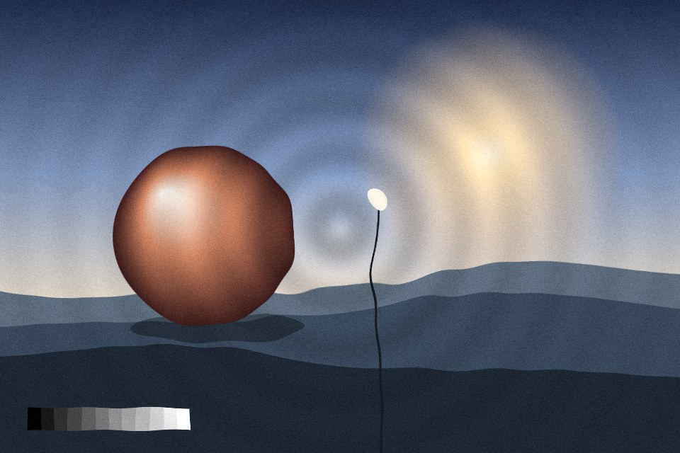

# Ripple lens

Concentric rings travel out from one point and push the picture along them, like looking down through disturbed water. Rings fade with distance.

Live demo: [`demo.html`](demo.html) (open the file in a browser; sliders change it live; "Your image" stays local).

| | |
|---|---|
| Group | Glass |
| Built with | WebGL 1 fragment shader (one pass) on the shared runtime |
| Fits | hero background with a water or sound story, a short reveal moment |

## How it works

Distance from an origin drives a sine wave that travels outward over time and fades exponentially. The wave pushes the sample point along the radius, and the slope of the wave brightens or darkens the ring slightly.

## Parameters

| Parameter | Range | Default |
|---|---|---|
| Displacement | 0 to 1 | 0.45 |
| Rings | 2 to 60 | 9 |
| Falloff | 0 to 1 | 0.55 |
| Speed | 0 to 2 | 0.4 |
| Origin X | 0 to 1 | 0.5 |
| Origin Y | 0 to 1 | 0.5 |
| Ring light | 0 to 1 | 0.35 |
| Grain | 0 to 0.3 | 0.05 |

## Performance

- Cost: Two texture reads per pixel. Animated at 30 fps it is light, but it is still a full-screen loop: pause it off screen (the runtime does).
- Mobile and fallback: No WebGL: the CSS gradient. Reduced motion: one still frame of the rings.
- Motion: 30 fps; one still frame under reduced motion; stops off screen.

## When to use

The content is about water, sound or a signal spreading out, and one origin point means something.

## When it becomes slop

Used as a cursor toy on a page about something else, or with strong rings behind text.
