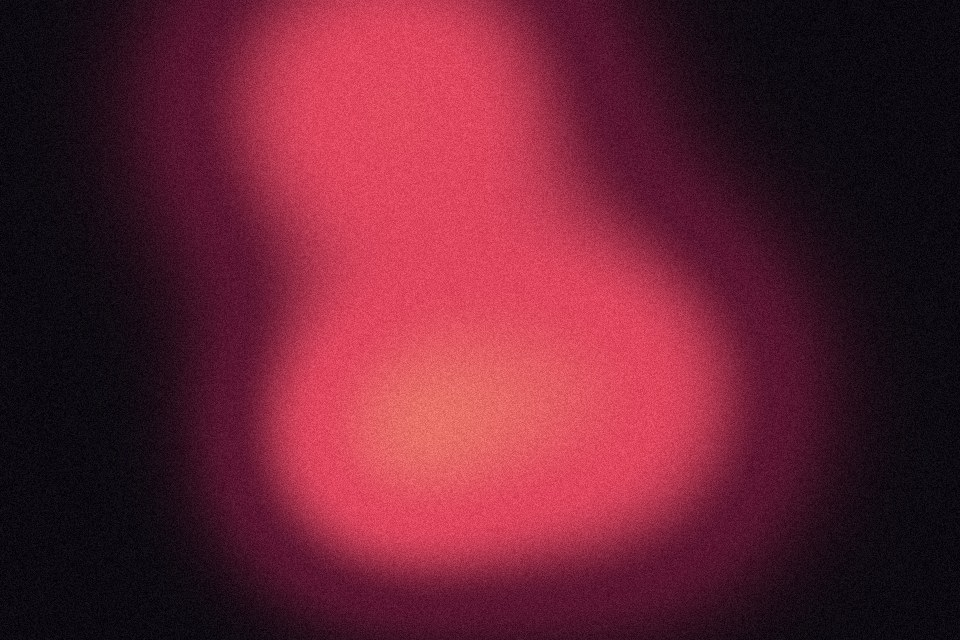

# Soft blobs

A few soft radial fields that add up where they overlap. The total is read through the palette from a hot core to a pale ground, so overlaps become a new colour rather than just brighter. Particle mode fills the frame with small ones.

Live demo: [`demo.html`](demo.html) (open the file in a browser; sliders change it live; "Your image" stays local).

| | |
|---|---|
| Group | Light and colour |
| Built with | WebGL 1 fragment shader (one pass) on the shared runtime |
| Fits | an aura behind a product or portrait, a particle field for a calm hero |

## How it works

Up to eight Gaussian fields at seeded positions around the centre. Merge mixes between the strongest single field (separate discs) and a soft sum (fused shapes). The total is read through the palette from ground to hot core. Particle mode puts one small field in each grid cell instead.

## Parameters

| Parameter | Range | Default |
|---|---|---|
| Count | 1 to 8 | 3 |
| Size | 0.05 to 1 | 0.38 |
| Softness | 0.05 to 1 | 0.75 |
| Spread | 0 to 0.6 | 0.32 |
| Merge | 0 to 1 | 1 |
| Shape | Circle / Squircle / Diamond | Circle |
| Layout | Scatter / Particles | Scatter |
| Seed | 0 to 50 | 12 |
| Drift | 0 to 1 | 0.3 |
| Grain | 0 to 0.3 | 0.08 |

## Performance

- Cost: Up to eight distance terms per pixel. Cheap. Drift loops at 30 fps.
- Mobile and fallback: No WebGL: the CSS gradient. A few blurred absolutely positioned circles are the CSS version, but they cost more on scroll than this canvas.
- Motion: 30 fps; still frame under reduced motion.

## When to use

Something needs a glow behind it, or a slow particle field suits the mood.

## When it becomes slop

Exactly the blurred purple orb behind a centred headline. Use few blobs, a palette from the project, grain on top, and give it a reason (an aura around a product, a light source).
