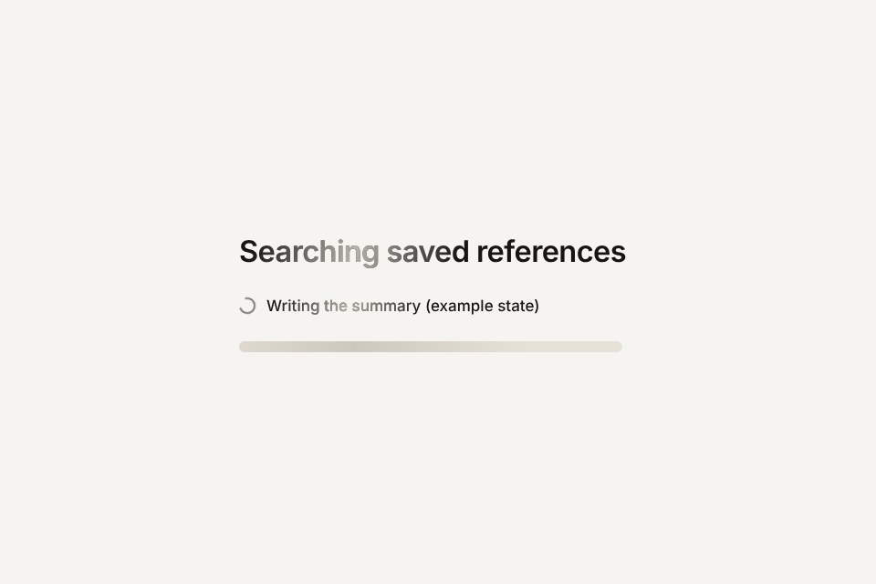

# Text shimmer

A light band that sweeps across a pending label, made with a masked copy of the text so the label itself keeps one solid colour and full contrast.

Live demo: [`demo.html`](demo.html) (open the file in a browser).

| | |
|---|---|
| Group | Finish |
| Built with | CSS only: a pseudo-element copy of the label and an animated mask position |
| Fits | "searching", "thinking", "generating" labels, skeleton rows, any state that waits for a result |

## How it works

The label carries its own text in a data attribute. A pseudo-element prints that text again in a lighter tone exactly on top. Its mask is a soft band inside a mask three times wider than the label; moving the mask position from 100 to 0 percent slides the band across in a straight line at constant speed. The real text never changes colour, so contrast checks, selection and screen readers see an ordinary label. The same mask moves across a skeleton bar.

## Parameters

| Parameter | Range | Default |
|---|---|---|
| Sweep (ms) | 600 to 4000 | 1300 |
| Band half-width (%) | 4 to 40 | 9 |
| Palette | ink on paper / light on night | ink on paper |

## Performance

- Cost: a mask position change on one small layer. Near zero.
- Mobile and fallback: without mask support the copy would cover the label in the lighter tone, so wrap the rule in `@supports (mask-image: linear-gradient(#000, #000))` in production.
- Motion: linear and infinite only while something is pending; stop it the moment the result arrives. Reduced motion hides the band and shows an ellipsis.

## When to use

A label stands for work in progress (a search, a generation, a sync) and a spinner alone says too little.

## When it becomes slop

It runs on labels that are not waiting for anything, on headlines as decoration, or it never stops after the work is done. A gradient fill on the text itself is a different, flagged move: here the text keeps one colour.
