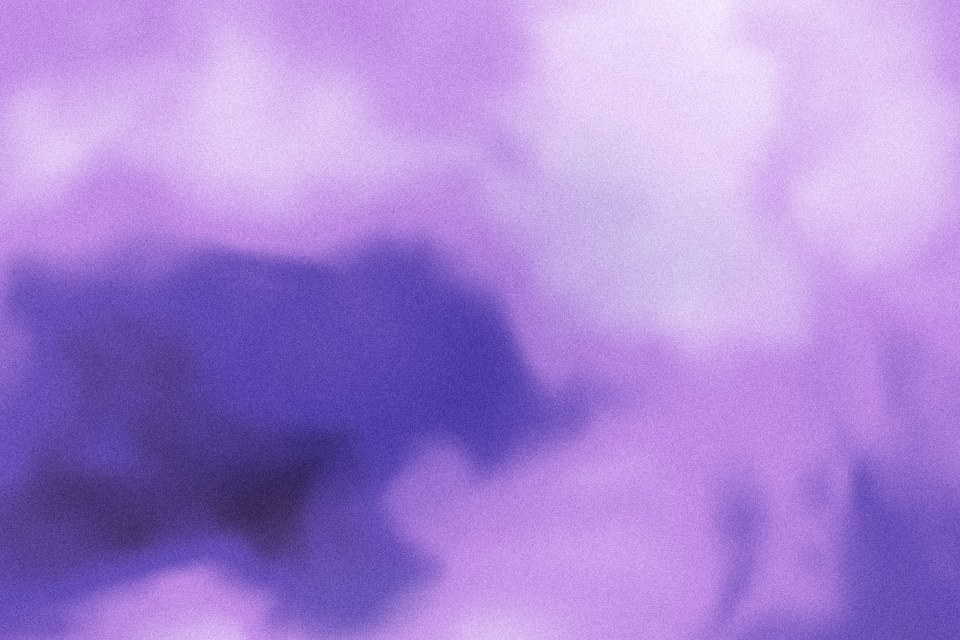

# Warped field

Noise that bends its own coordinates twice before it is read, mapped through the palette. It gives soft, painterly, smoke-like bands that never repeat. The most organic background here.

Live demo: [`demo.html`](demo.html) (open the file in a browser; sliders change it live; "Your image" stays local).

| | |
|---|---|
| Group | Light and colour |
| Built with | WebGL 1 fragment shader (one pass) on the shared runtime |
| Fits | hero backgrounds, section bands, abstract card media |

## How it works

Noise read at coordinates that were themselves displaced by noise, twice (domain warping). The result runs through the four-colour palette ramp, with a little of the first warp layer mixed back for depth.

## Parameters

| Parameter | Range | Default |
|---|---|---|
| Scale | 0.3 to 6 | 1.6 |
| Warp | 0 to 3 | 0.9 |
| Detail (octaves) | 1 to 6 | 4 |
| Contrast | 0.3 to 2.5 | 0.9 |
| Flow | 0 to 1 | 0.25 |
| Grain | 0 to 0.3 | 0.07 |

## Performance

- Cost: Three layered noise calls of up to six octaves per pixel: the heaviest generator in this set. On phones lower Detail, cap at 30 fps, or render one still frame.
- Mobile and fallback: No WebGL: the CSS gradient. Export one frame as a 1600 px WebP for a zero-script version.
- Motion: 30 fps; still frame under reduced motion. Heaviest generator: lower Detail on phones.

## When to use

You want an organic, painterly field with no visible repetition.

## When it becomes slop

Full saturation and full contrast (it turns into a screensaver), or used behind long text. Keep contrast low and let one colour dominate.
