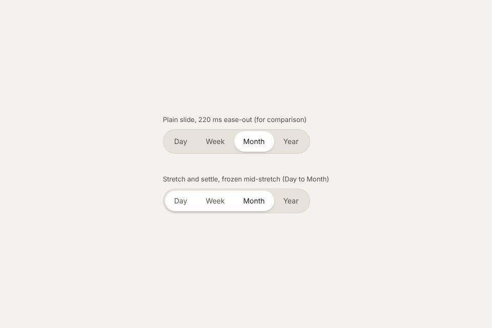
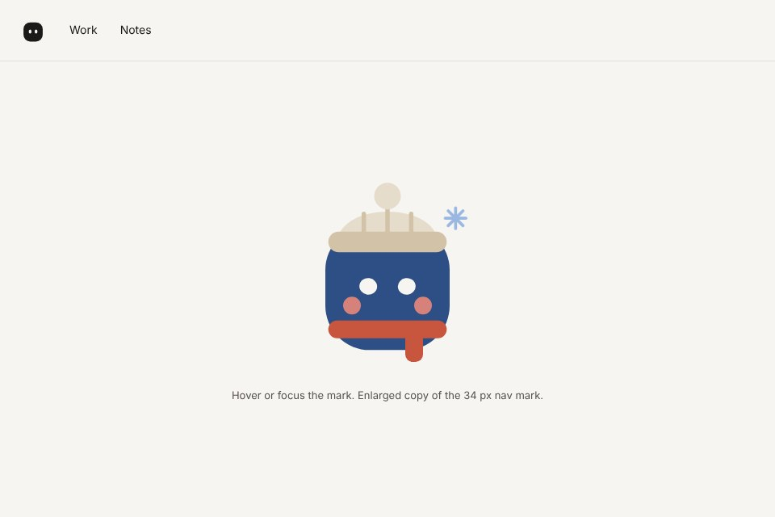
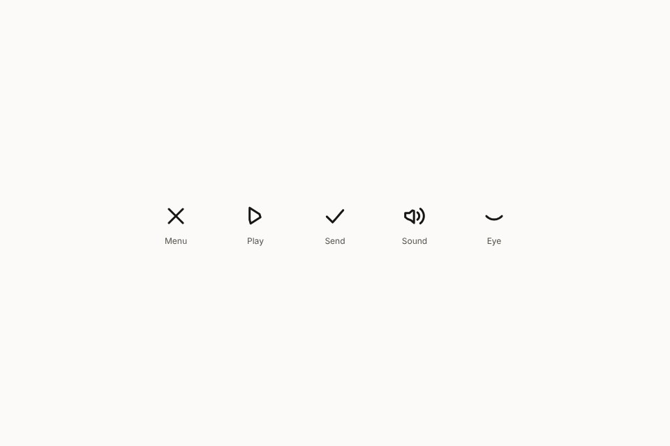
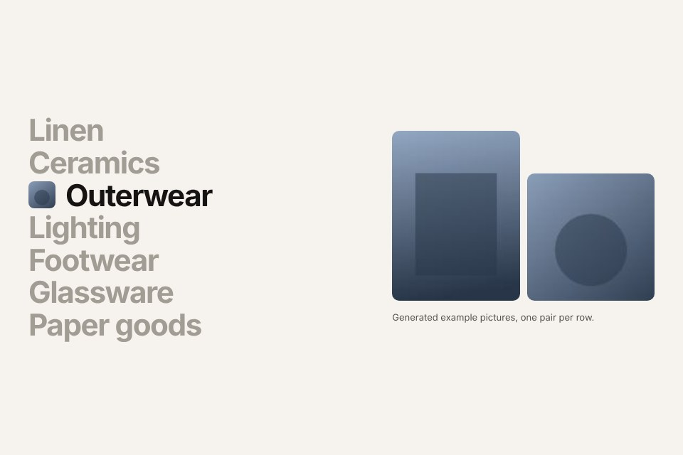
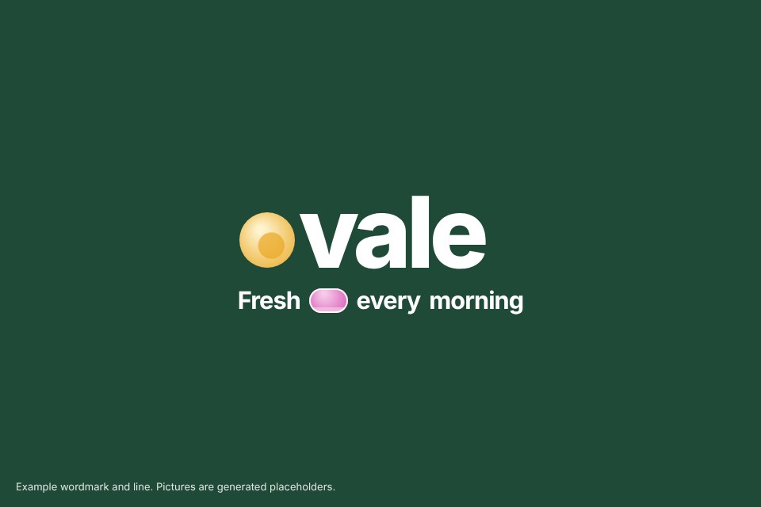
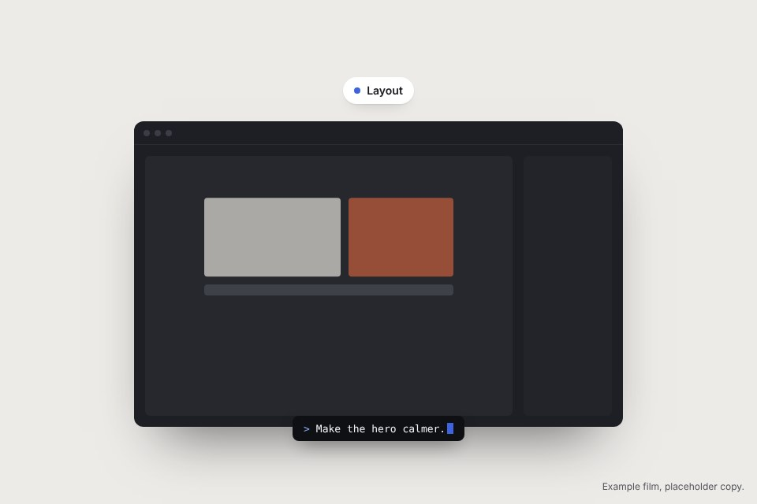
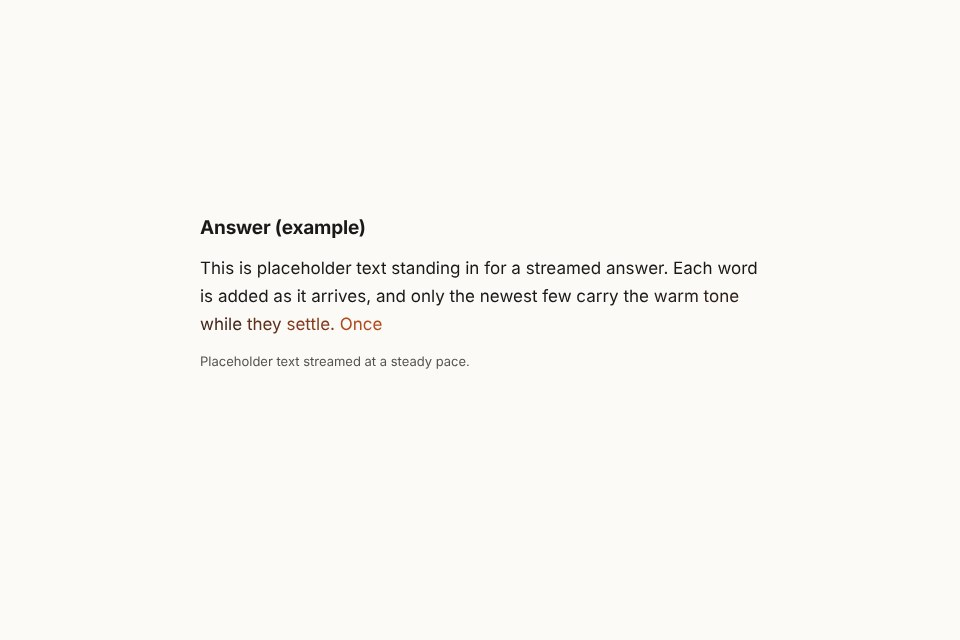

# Interaction and motion recipes

Small interactions and short sequences, measured on real products and rebuilt by hand. Each folder has one self-contained `demo.html` (no network, no packages) with the timings written next to the controls, and a `screenshot.jpg`. Effects (texture, light, glass) live in `../effects/`; these are about how things move and answer.

Group them by the verb they serve, not by how they look: **select**, **show state**, **hover**, **open**, **tell a sequence**, **stream**.

| Recipe | Verb | What it does | Key numbers |
|---|---|---|---|
| [Stretch and settle](stretch-settle/) | select | indicator stretches over old and new choice, then settles with a small overshoot | 190 ms cubic-bezier(.32,.72,.24,1), then 420 ms cubic-bezier(.28,1.28,.36,1); press tilt 4 deg, 160 ms |
| [Rolling status pill](rolling-pill/) | show state | a pill above the headline rolls between two or three true lines and resizes to fit | roll and width 420 ms cubic-bezier(.22,1,.36,1); hold about 3 s |
| [Mark with a hidden turn](mark-turn/) | hover | the logo mark changes costume part by part; eyes follow the pointer | parts 320 to 460 ms with overshoot, 0 to 120 ms stagger; flicker 1.8 s step-end |
| [Morphing icons](morph-icons/) | show state | icons move their own points between states | spring about 500 ms, no bounce; two-step 620 ms cubic-bezier(.65,0,.35,1) |
| [Index list reveal](index-reveal/) | hover | big type index; pointed row opens an inline picture, others step back | colour 220 ms, picture 260 ms cubic-bezier(.2,.8,.2,1) |
| [Letter window](letter-window/) | tell a sequence | a round letter of the wordmark shows flicking pictures, lands, then the line arrives | 200 ms per picture, words 300 ms apart, pill pop 360 ms |
| [Prompt-led product reel](prompt-reel/) | tell a sequence | checklist resolves, title darkens word by word, window slides in while a command types | 40 characters per second, lines every 400 ms, window 700 ms ease-out |
| [Streaming tail](streaming-tail/) | stream | the newest words arrive in a warm tone and settle into ink | settle about 600 ms ease-out |

## Rules every recipe follows

- Timings are written down (duration and curve) and come from measurement, then were checked by eye at 1440 and 390 wide.
- Sequences are a pure function of time, `render(t)`, with a scrubber: testable, exportable as frames, frozen at the last frame under reduced motion.
- Only transform, opacity and colour animate, except where a small element's width has to follow its content (pill, indicator); that is noted.
- Hover is never the only way: focus does the same, and on touch screens the content stands without it.
- Placeholder copy is labelled as an example once per demo; no invented numbers.

## Screens

| | |
|---|---|
|  |  |
|  |  |
|  |  |
|  |  |

## Building and checking

```
node recipes/capture.mjs                     # fresh screenshot.jpg for every recipe; fails on a page error
node recipes/capture.mjs letter-window --ui out/   # one recipe, plus the page at 1440 and 390
```

To add a recipe: a folder with `demo.html` that sets `window.__fxReady = true` when drawn and honours `?shot=1` (controls hidden, a representative frame), a row in the table above, then run the capture.
